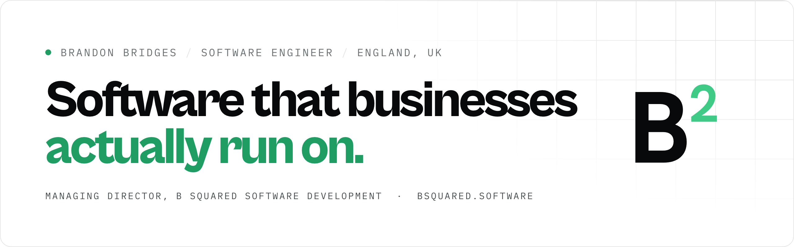
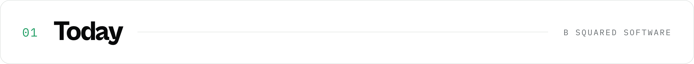
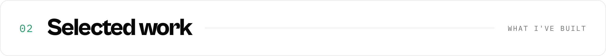

<picture>
  <source media="(prefers-color-scheme: dark)" srcset="assets/profile-header-dark.png">
  
</picture>

 

I've spent ten years building software for other people's businesses: CRMs for a healthcare group, fleet and workshop systems for transport, project management for construction. The pattern is nearly always the same. A business outgrows its spreadsheets, buys a product that does 80% of the job, and someone ends up doing the other 20% by hand.

That 20% is what I build.

 

<picture>
  <source media="(prefers-color-scheme: dark)" srcset="assets/title-today-dark.png">
  
</picture>

In June 2026 I founded **[B Squared Software Development](https://bsquared.software)** with Paige. We build bespoke software for UK businesses: line-of-business systems, internal tools, customer portals and the integrations between them.

More and more of that work is AI: agents that work inside a business's own systems and ask before they change anything, extraction that turns documents into structured data, and tests that show whether a model is right before anyone relies on it.

- **Fixed price, scoped in writing.** You know what you're getting and what it costs before anything is built.
- **One senior engineer, end to end.** The person who scopes the work writes it and ships it. No hand-offs.
- **You own it from day one.** The code, the hosting and the accounts are in your name, so nobody is locked in to their developer.
- **Proven, boring tech,** so any good engineer could pick it up after us.

If you know a business that's still held together by a spreadsheet, I'd love an introduction: **brandon@bsquared.software**

 

<picture>
  <source media="(prefers-color-scheme: dark)" srcset="assets/title-work-dark.png">
  
</picture>

| Project | What it is |
|---|---|
| **Fortium** Accountancy · 2026 | A platform of six applications replacing an accountancy practice's end-of-life practice-management system: a staff dashboard, a client portal, document extraction for invoices and catalogue data, and a NestJS API with typed contracts shared by every frontend. Live and in daily use. |
| **Fortium AI** Accountancy · 2026 | The AI layer across the same platform. A staff assistant that looks things up and takes actions through permission-checked tools, and always asks before it writes. Answers grounded in the accounting standards and the firm's own documents, with sources (pgvector). Document classification and extraction on background queues. And a toolbox for tax and accounts prep where the model reads the paperwork and deterministic engines do the maths, checked to the penny by independent Python verifiers. Behind it: an evaluation harness, prompt-injection testing and a provider layer that runs on Claude or open models. |
| **[Curbed](https://curbed.cab)** Our own product · 2026 | Multi-tenant fleet-damage software: drivers report damage by scanning a QR code, mechanics work through the repairs and managers see the whole fleet. Live with a taxi operator in the Netherlands. |
| **Project Commander** Construction · 2024–2026 | A multi-tenant project management platform for the UK construction industry, from first commit to production, now serving 10+ client organisations. Next.js and PostgreSQL, with a NestJS API, Redis caching, real-time updates and Xero and Sage integrations. Alongside it: a single sign-on server, a shared component library and a report engine that builds PDF and Word documents from templates. |
| **VAPTA** Transport · 2021–2022 | Six connected platforms for fleet and workshop management, serving 10,000+ vehicles and 20,000+ drivers across the UK: a DVSA Earned Recognition accredited inspection tool, workshop management with Sage, Xero and QuickBooks integrations, parts procurement, barcode stock control and a driver walkaround app. |
| **Healthcare CRMs** Healthcare · 2018–2020 | As sole developer for a healthcare group, a bespoke CRM for an occupational health screening business and a patient and referrals system for a veterans' hearing charity. I also rebuilt three websites: pages loaded 50% faster and organic search traffic went up 80%. |

 

<picture>
  <source media="(prefers-color-scheme: dark)" srcset="assets/title-career-dark.png">
  
</picture>

| When | Role | Where |
|---|---|---|
| 2026 – now | **Managing Director** | [B Squared Software Development](https://bsquared.software) |
| 2024 – 2026 | **Lead Developer**, sole technical lead | Ensign Software, Leicester |
| 2021 – 2022 | **Full-stack Developer** | Vapta Systems, Ashbourne |
| 2018 – 2020 | **Web Developer**, sole developer | BHHC (Hear4U, Healthscreen UK, UK Veterans Hearing Help), Hinckley |
| 2016 – 2018 | **WordPress Developer** | Renaissance Creative Design & Print, Rugby |

I started as a junior developer at an agency. Two weeks in, the creative lead and the lead web developer both left, and I ended up running the agency's web work. That's where I learned to work on my own, look after clients and deliver under pressure, and it shaped everything after.

 

<picture>
  <source media="(prefers-color-scheme: dark)" srcset="assets/title-oss-dark.png">
  
</picture>

- **[Thought Desk](https://github.com/kusule1351-hue/thought-desk/issues/1)**: performance fixes for a new open-source notes app. On a 50,000-row table, typing in another page went from freezing the window for 4.4 s to not at all, and a save that could wait 38 s behind search now takes under 16 ms. Six PRs, done pro bono.
- **[Vigil](https://github.com/bsquared-software/vigil)**: a native macOS server monitor with live metrics, Docker, a terminal and files for your Linux servers, all over SSH.
- **[Lumen](https://github.com/bsquared-software/lumen)**: a native macOS menu bar display manager for monitors, brightness, resolutions and presets.
- **[Conan Exiles Server Manager](https://github.com/brandonrbridges/conan-exiles-server-manager)**: a free desktop manager for Conan Exiles servers, with multi-server live admin over RCON.

 

<picture>
  <source media="(prefers-color-scheme: dark)" srcset="assets/title-stack-dark.png">
  
</picture>

| Area | Tools |
|---|---|
| **Languages** | TypeScript, JavaScript, Python, Swift, PHP |
| **Frontend** | Next.js, React, SwiftUI |
| **Backend** | NestJS, Node.js, REST, Socket.IO |
| **Data** | PostgreSQL, Redis, Firebase |
| **Infrastructure** | Docker, self-hosted Linux, CI/CD pipelines |
| **AI** | Claude API, open models (Ollama), tool-use agents, MCP servers, RAG with pgvector, structured and vision extraction, evals |
| **Integrations** | Xero, Sage, QuickBooks, HMRC, Companies House, single sign-on |

 

<picture>
  <source media="(prefers-color-scheme: dark)" srcset="assets/title-life-dark.png">
  
</picture>

My favourite thing in the world is my little girl. Watching her grow and thrive is the best part of every day.

 

  <a href="https://bsquared.software"><b>bsquared.software</b></a> &nbsp;·&nbsp;
  <a href="mailto:brandon@bsquared.software">brandon@bsquared.software</a> &nbsp;·&nbsp;
  <a href="https://www.linkedin.com/in/brandonrbridges0">LinkedIn</a> &nbsp;·&nbsp;
  <a href="https://github.com/bsquared-software">@bsquared-software</a>

